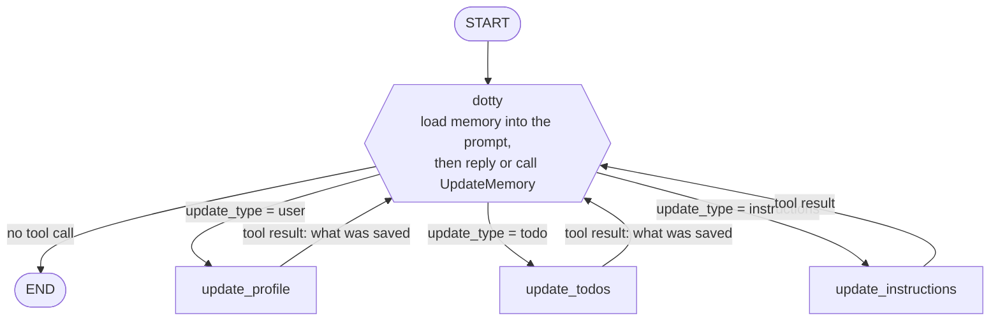
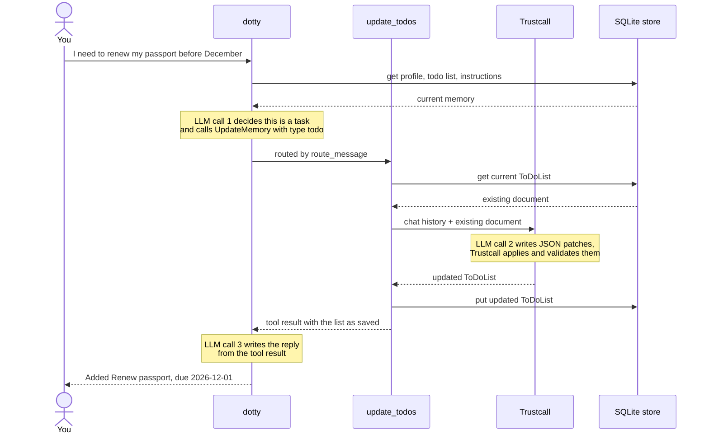
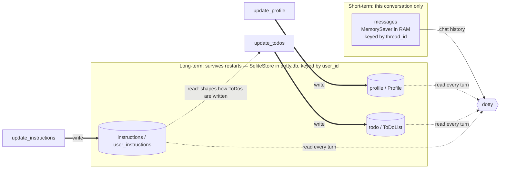
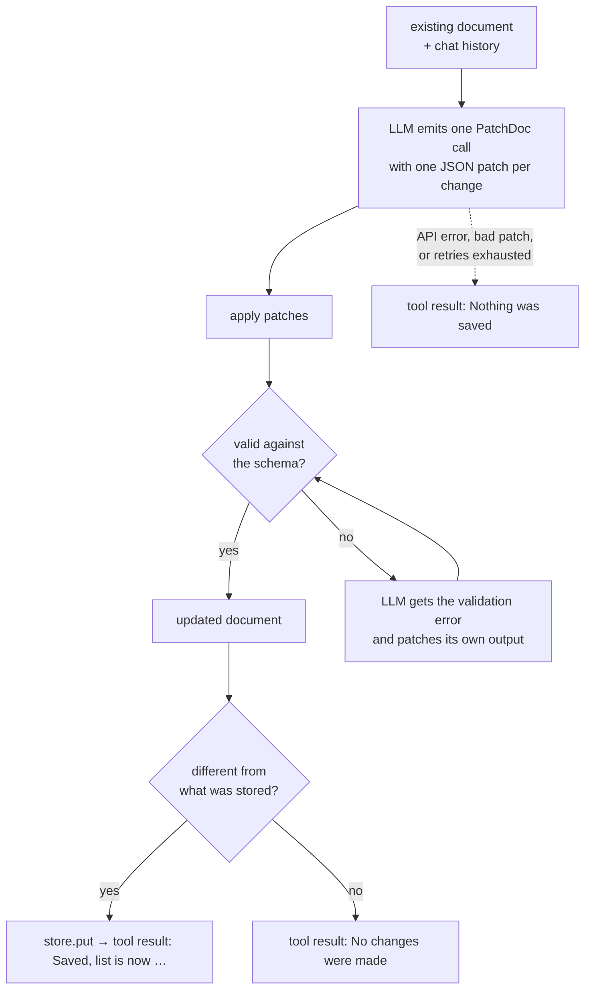

# Dotty

A personal AI assistant that remembers you. Dotty is a small [LangGraph](https://docs.langchain.com/oss/python/langgraph/overview) agent that chats in your terminal and keeps long-term memory of who you are, what's on your ToDo list, and how you like your ToDos written. Memory is saved to a local SQLite file, so it survives restarts.

It started as the `memory_agent.ipynb` notebook from LangChain Academy (module 5) and was turned into something you can actually run.

## Quickstart

```bash
pip install -r requirements.txt
cp .env.example .env        # then put your Groq API key in it
python dotty.py
```

```
Dotty is ready. /memory shows what I remember, /quit exits.
you> I'm Sai, I live in Hyderabad. I need to renew my passport before December.
dotty> I've added "Renew passport" to your list with a deadline of 2026-12-01.
you> /memory
[profile]
  {'name': 'Sai', 'location': 'Hyderabad', ...}
[todo]
  {'todos': [{'task': 'Renew passport', 'deadline': '2026-12-01', 'status': 'not started', ...}]}
[instructions]
you> /quit
```

*(Illustrative session: exact wording depends on the model.)*

Quit, start it again, and ask "what's on my list?" Dotty still knows.

## What Dotty remembers

| Memory | Kind | Shape | Example trigger |
|---|---|---|---|
| **Profile** | semantic | one `Profile` document: name, location, job, connections, interests | "I live in Hyderabad with my sister" |
| **ToDo list** | semantic | one `ToDoList` document holding a list of `ToDo` items: task, time estimate, deadline, solutions, status | "I need to renew my passport" |
| **Instructions** | procedural | free text describing how you want ToDos written | "Always include a time estimate" |

Dotty decides for itself *whether* a message is worth remembering and *which* memory it belongs to. Small talk saves nothing.

## How a turn works

The graph has one chat node and three memory-writing nodes. The chat node either answers, or calls a single tool, `UpdateMemory(update_type)`, whose argument picks the branch.



Every update node loops back to `dotty`, which reads the tool result and then answers you (or updates a *different* memory, if your message touched more than one). Each memory type is updated at most once per message, so the loop always ends.

Here is one full turn for "I need to renew my passport before December":



A message that saves something costs three model calls. A message that saves nothing costs one.

## Where memory lives

There are two separate memories, keyed differently on purpose.



- **Short-term memory** is the message list. Every run of `python dotty.py` starts a new `thread_id`, so the chat history starts empty.
- **Long-term memory** is three documents in a namespaced key-value store: `("profile", user_id)`, `("todo", user_id)`, `("instructions", user_id)`. They are loaded into the system prompt on every turn, which is how a brand-new conversation already knows you.

## How memory gets written: Trustcall

Asking an LLM to re-emit a whole JSON document every time it changes is slow and lossy: it drops fields and rewrites things you didn't ask about. [Trustcall](https://github.com/hinthornw/trustcall) has the model emit **JSON patches** against the existing document instead, then validates the result against the Pydantic schema and asks the model to repair it if validation fails.



So "mark the gift as done and add file my taxes" becomes one call carrying two patches:

```json
[
  {"op": "replace", "path": "/todos/1/status", "value": "done"},
  {"op": "add", "path": "/todos/-", "value": {"task": "File my taxes", "status": "not started"}}
]
```

The **instructions** memory is simpler: it is free text, so `update_instructions` just asks the model to rewrite it and overwrites the stored copy. Those instructions are then fed to Trustcall whenever the ToDo list is updated.

## What changed from the notebook

The notebook's graph is the starting point, but running it for real against `openai/gpt-oss-120b` on Groq exposed several things that had to change.

| Notebook | Dotty | Why |
|---|---|---|
| `InMemoryStore` | `SqliteStore` in `dotty.db` | Memory has to survive a restart to be worth having. |
| Each ToDo is its own document; adding and editing in one go relies on parallel tool calls | The ToDo list is **one document**; one `PatchDoc` call carries several patches | This model emits one tool call per response. With one document per ToDo, "do X and add Y" silently saved only one of the two. |
| Tool result is built from the tool calls Trustcall *attempted* | Tool result is built from what was *actually stored* | When a patch failed, the old message still read like a success and the assistant told the user it had saved something it hadn't. |
| The chat node can call `UpdateMemory` any number of times | Each memory type is updated at most once per message | The model sometimes re-requested the same update in a loop, adding duplicate ToDos each time. |
| `deadline: datetime`, `time_to_complete` required | `deadline: str`, every field has a default | Groq validates tool arguments against the JSON schema and rejects the whole call for a date-only string or a missing field. |
| Trustcall runs with the default step limit | Trustcall is capped at 10 internal steps | Trustcall swallows model API errors and retries with no cap of its own, which burns through a rate limit quickly. |
| Prompt has the date | Prompt has the weekday too | "By next Friday" came out as the wrong date without it. |
| Node is called `task_mAIstro` | Node is called `dotty` | It's Dotty. |

## Files

| File | What it is |
|---|---|
| `dotty.py` | The whole agent: schemas, prompts, the four nodes, the graph, and the terminal chat loop |
| `test_dotty.py` | Offline self-check using a scripted fake model (no API key or network needed) |
| `langgraph.json` | Lets LangGraph Studio load the graph |
| `.env.example` | The environment variables Dotty reads |
| `dotty.db` | Created on first run. Your memory. Git-ignored. |

## Tests

```bash
python test_dotty.py
```

It replaces the Groq model with a scripted one and checks routing, a full turn through the graph, multi-patch updates, the repeat-update guard, and that failed updates are reported as failures.

## LangGraph Studio

```bash
pip install "langgraph-cli[inmem]"
langgraph dev
```

Studio supplies its own store and checkpointer, so memory there is separate from `dotty.db`. Set `user_id` in the run's configuration to keep separate memories per user; it defaults to `default-user`.

## Limitations

- **Rate limits.** Groq's free tier allows 200,000 tokens per day on `openai/gpt-oss-120b`, and a message that updates memory makes three model calls. Change `MODEL` at the top of `dotty.py` to use a different Groq model.
- **One list, one document.** The whole ToDo list goes into the prompt on every turn. That is fine for a personal list and will not scale to hundreds of tasks.
- **Single user in the terminal.** The chat loop always uses `default-user`. The graph itself is per-user (`user_id` in the config).
- **The model does the date maths.** Relative deadlines ("in two weeks") are resolved by the LLM and can be off; `/memory` shows what was actually stored.

## Credits

Based on the [LangChain Academy](https://github.com/langchain-ai/langchain-academy) *Introduction to LangGraph* course, module 5 (`memory_agent.ipynb`), MIT licensed.
